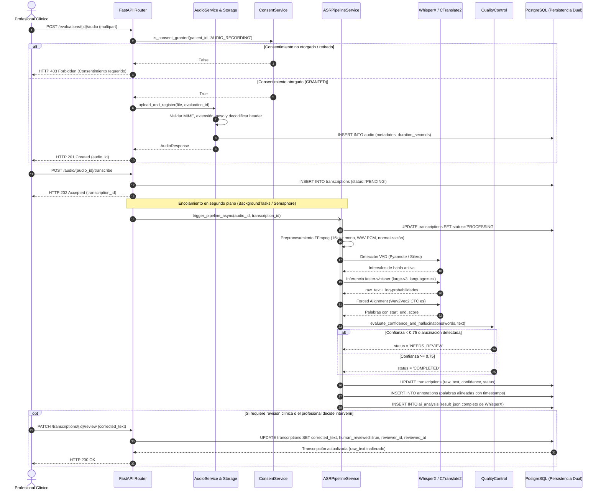
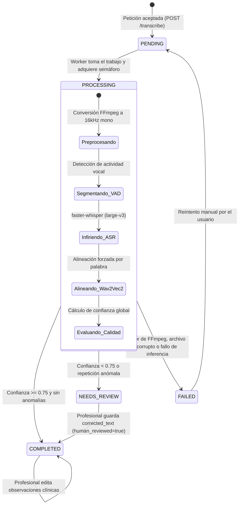

# Documento de Diseño Técnico: Pipeline ASR (AI1) en LINGUA

- **Identificador del Cambio:** `implement-ai1-asr-pipeline`
- **Subsistema:** `AI1 — Automatic Speech Recognition Pipeline`
- **Fecha:** 24 de noviembre de 2026
- **Estado:** Diseño Aprobado para Especificación

---

## 1. Visión General y Arquitectura del Subsistema AI1

El subsistema AI1 se integra directamente dentro de la arquitectura de **Monolito Modular Asíncrono** de LINGUA, preservando la inversión de dependencias y el desacoplamiento por capas:

```
┌────────────────────────────────────────────────────────┐
│           Capa de Transporte (FastAPI Routers)         │
│   • /api/v1/evaluations/{id}/audio                     │
│   • /api/v1/audio/{id}/transcribe                      │
│   • /api/v1/transcriptions/{id}                        │
│   • /api/v1/transcriptions/{id}/review                 │
│   • /api/v1/transcriptions/{id}/export                 │
├────────────────────────────────────────────────────────┤
│          Capa de Seguridad, Auth & Dependencias        │
│    • Supabase JWT (HS256)                              │
│    • require_professional_or_admin (RBAC)              │
│    • ConsentService.is_consent_granted()               │
├────────────────────────────────────────────────────────┤
│            Capa de Servicios de Dominio (AI1)          │
│   • AudioService & StorageService                      │
│   • ASRPipelineService (Orquestador de 10 Etapas)      │
│   • AudioPreprocessor (FFmpeg 16kHz mono)              │
│   • WhisperXEngine (CTranslate2 + large-v3)            │
│   • VAD & ForcedAlignment (Wav2Vec2 CTC es)            │
│   • QualityControlEvaluator & ExportService            │
├────────────────────────────────────────────────────────┤
│           Capa de Repositorios (Acceso a Datos)        │
│   • AudioRepository, TranscriptionRepository           │
│   • AnnotationRepository, AIAnalysisRepository         │
├────────────────────────────────────────────────────────┤
│         Capa de Base de Datos y Almacenamiento         │
│   • PostgreSQL / Supabase: audio, transcriptions, etc. │
│   • Almacenamiento: Disco local seguro / Supabase      │
└────────────────────────────────────────────────────────┘
```

---

## 2. Diagramas de Flujo y Arquitectura (Mermaid)

### 2.1. Diagrama de Secuencia de las Diez Etapas de AI1



### 2.2. Diagrama de Estados del Ciclo de Vida de la Transcripción



---

## 3. Mapeo Exhaustivo de las Diez Etapas de AI1

| # | Etapa AI1 | Responsabilidad Técnica | Componente Encargado | Interacción DB / Almacenamiento |
|---|---|---|---|---|
| **1** | **Ingesta de audio** | Recepción HTTP `multipart/form-data`, asignación de UUID y stream seguro a disco/storage. | `AudioService`, `StorageService` | Escribe archivo físico y crea registro en `public.audio`. |
| **2** | **Validación** | Verificación MIME, formato, tamaño máx ($\le 50$MB) y comprobación bioética estricta. | `AudioService`, `ConsentService` | Consulta `patient_consents` (requiere `GRANTED`). Rechaza 403/413/422. |
| **3** | **Preprocesamiento** | Invocación de FFmpeg para forzar WAV PCM 16kHz, mono, 16-bit y normalización a -20 dBFS. | `AudioPreprocessor` | Genera archivo temporal canónico en `/tmp` o carpeta de trabajo. |
| **4** | **VAD** | Detección de actividad vocal para aislar el habla y suprimir silencios o ruidos no verbales. | Pyannote VAD / Silero VAD (vía WhisperX) | Genera lista de intervalos temporales con voz activa. |
| **5** | **Inferencia ASR** | Transcripción del habla al español utilizando Whisper `large-v3` optimizado con CTranslate2. | `WhisperXEngine` (faster-whisper) | Genera `raw_text` y probabilidades de tokens. |
| **6** | **Alineación forzada** | Alineación temporal palabra por palabra mediante modelo acústico fonético Wav2Vec2 CTC. | `Wav2Vec2 CTC Aligner` (español) | Obtiene marcas milimétricas `start`, `end`, `word` y `score`. |
| **7** | **Control de calidad** | Cálculo de confianza agregada $[0, 1]$, detección de alucinaciones y umbral de alerta. | `QualityControlEvaluator` | Determina si el estado final pasa a `COMPLETED` o `NEEDS_REVIEW`. |
| **8** | **Revisión humana** | Interfaz *Human-in-the-Loop* para auditar el audio, registrar `corrected_text` y autoría. | `TranscriptionService` | Actualiza `corrected_text`, `human_reviewed=true`, `reviewer_id`, `reviewed_at`. |
| **9** | **Persistencia dual** | Guardado simultáneo en tablas relacionales SQL y en documento estructurado JSONB. | Repositorios (`Transcription`, `Annotation`, `AIAnalysis`) | Registra en `transcriptions`, `annotations` (palabras) y `ai_analysis` (`result_json`). |
| **10** | **Exportación** | Ensamblado bajo demanda de entregables en JSON enriquecido, subtítulos SRT y Praat TextGrid. | `ExportService` | Lee de base de datos y genera archivos en memoria sin re-procesar audio. |

---

## 4. Componentes Existentes vs. Componentes Nuevos

```
backend/app/
├── core/
│   ├── config.py                       [MODIFICAR: Agregar variables ASR y Storage]
│   └── exceptions.py                   [REUTILIZAR: EntityNotFound, ValidationException, etc.]
├── db/
│   ├── base.py                         [REUTILIZAR: GUID, AuditMixin, Base]
│   ├── session.py                      [REUTILIZAR: AsyncSessionLocal, transacciones async]
│   └── models/
│       ├── pipeline.py                 [REUTILIZAR 100%: Audio, Transcription, Annotation, AIAnalysis]
│       ├── evaluation.py               [REUTILIZAR: Evaluation, EvaluationSubtest]
│       └── consent.py                  [REUTILIZAR: PatientConsent]
├── schemas/
│   ├── audio.py                        [NUEVO: AudioUploadResponse, AudioDetailResponse]
│   └── transcription.py                [NUEVO: TranscriptionResponse, ReviewUpdate, WordSegment]
├── repositories/
│   ├── base.py                         [REUTILIZAR: BaseRepository genérico]
│   ├── consent_repository.py           [REUTILIZAR]
│   ├── audio_repository.py             [NUEVO: Consultas y filtros de audio]
│   ├── transcription_repository.py     [NUEVO: get_by_audio, list_pending_review]
│   ├── annotation_repository.py        [NUEVO: bulk_insert de palabras alineadas]
│   └── ai_analysis_repository.py       [NUEVO: persistencia de result_json]
├── services/
│   ├── consent_service.py              [REUTILIZAR: is_consent_granted]
│   ├── storage_service.py              [NUEVO: Abstracción de storage local / Supabase]
│   ├── audio_service.py                [NUEVO: Ingesta, validación, metadatos]
│   ├── transcription_service.py        [NUEVO: Gestión y revisión humana]
│   └── asr/                            [NUEVO PAQUETE: Motor de Machine Learning AI1]
│       ├── __init__.py
│       ├── audio_preprocessor.py       [NUEVO: Wrapper FFmpeg canónico 16kHz mono]
│       ├── whisperx_engine.py          [NUEVO: Singleton CTranslate2 + faster-whisper]
│       ├── alignment_service.py        [NUEVO: Wav2Vec2 CTC for Spanish]
│       ├── quality_control.py          [NUEVO: Métricas, umbral 0.75, alucinaciones]
│       ├── export_service.py           [NUEVO: Generador JSON, SRT y Praat TextGrid]
│       └── asr_pipeline_service.py     [NUEVO: Orquestador de las 10 etapas]
└── api/v1/
    ├── router.py                       [MODIFICAR: Registrar routers audio y transcriptions]
    └── endpoints/
        ├── audio.py                    [NUEVO: Endpoints de subida y consulta de audio]
        └── transcriptions.py           [NUEVO: Endpoints de ASR, review y exportación]
```

---

## 5. Estrategia de Almacenamiento de Archivos (`StorageService`)

Para mantener el acoplamiento mínimo y permitir el desarrollo local sin depender obligatoriamente de la red o de buckets de Supabase, se define un patrón de estrategia (*Strategy Pattern*):

```python
class StorageService(ABC):
    @abstractmethod
    async def save_file(self, file_content: bytes, destination_path: str) -> str: ...
    @abstractmethod
    async def get_file_stream(self, file_path: str) -> BinaryIO: ...
    @abstractmethod
    async def delete_file(self, file_path: str) -> bool: ...
    @abstractmethod
    async def generate_access_url(self, file_path: str, expires_in_seconds: int = 3600) -> str: ...
```

- **Driver Local (`LocalStorageService`):** Almacena en ruta segura configurada en `AUDIO_STORAGE_PATH` (ej. `./data/audio/`). No expuesta directamente a la web; el acceso a streaming se gestiona a través de un endpoint autenticado con streaming de FastAPI (`StreamingResponse`).
- **Driver Supabase (`SupabaseStorageService`):** Utiliza las credenciales `SUPABASE_URL` y `SUPABASE_SERVICE_ROLE_KEY` contra el bucket privado `clinical-audio`. Las URLs de acceso son URLs presignadas con caducidad temporal (1 hora).

---

## 6. Estrategia de Concurrencia y Aislamiento del Event Loop

1. **Invocación Desacoplada:** El endpoint `POST /audio/{id}/transcribe` no ejecuta la inferencia directamente; valida la existencia del audio, inicializa `Transcription(status='PENDING')` y despacha el trabajo a un orquestador en segundo plano mediante `BackgroundTasks` de FastAPI o `asyncio.to_thread`.
2. **Semáforo de Concurrencia:** La inferencia en GPU/CPU es un recurso intensivo en RAM/VRAM. Se implementa un semáforo global `asyncio.Semaphore(settings.MAX_CONCURRENT_ASR_JOBS)` (por defecto `1` en CPU local, configurable hasta `2-4` en GPU de producción) para evitar que múltiples solicitudes saturen la memoria RAM y disparen un fallo `OutOfMemory` (OOM).
3. **Aislamiento en ThreadPool:** Dado que CTranslate2 y PyTorch ejecutan código C++ bloqueante de CPU, las llamadas a `engine.transcribe()` y `aligner.align()` se envuelven estrictamente en `await asyncio.to_thread(...)`, garantizando que el bucle de eventos de FastAPI continúe respondiendo a peticiones HTTP (salud, consultas de pacientes, etc.) con latencias milimétricas.

---

## 7. Configuración Centralizada y Soporte Multi-Hardware

Se añaden las siguientes variables a [`backend/app/core/config.py`](file:///c:/Users/refgu/OneDrive/Documentos/GitHub/Lingua/backend/app/core/config.py):

```python
# --- Configuración ASR (AI1 Pipeline) ---
ASR_DEVICE: str = "cpu"                  # "cpu" en desarrollo local, "cuda" en producción
ASR_COMPUTE_TYPE: str = "int8"           # "int8" en CPU AVX2, "float16" en GPU CUDA
ASR_MODEL_SIZE: str = "large-v3"         # Modelo objetivo de Whisper
ASR_LANGUAGE: str = "es"                 # Forzado a español clínico
ASR_BEAM_SIZE: int = 5
ASR_CONFIDENCE_THRESHOLD: float = 0.75   # Umbral de calidad para SCRUM-24
MAX_CONCURRENT_ASR_JOBS: int = 1         # Concurrencia máxima de inferencias simultáneas
HUGGINGFACE_TOKEN: Optional[str] = None  # Token para Pyannote VAD

# --- Almacenamiento de Audio ---
STORAGE_DRIVER: str = "local"            # "local" | "supabase"
AUDIO_STORAGE_PATH: str = "./data/audio" # Directorio base para driver local
MAX_AUDIO_SIZE_MB: int = 50              # Límite máximo por archivo
```

---

## 8. Persistencia Dual Consistente

Para evitar estados inconsistentes (por ejemplo, que la transcripción se guarde pero las palabras alineadas fallen), toda la persistencia de la Etapa 9 se ejecuta dentro de un **bloque de transacción atómica de SQLAlchemy**:

1. Se actualiza la fila cabecera en `public.transcriptions`:
   ```sql
   UPDATE transcriptions SET raw_text = :text, confidence = :conf, processing_status = :st, asr_model = 'whisper-large-v3', updated_at = NOW() WHERE transcription_id = :id;
   ```
2. Se realiza una inserción masiva (`bulk_insert`) en `public.annotations`:
   Cada palabra se persiste como `Annotation(annotation_type='WORD', text=word, start_time_seconds=start, end_time_seconds=end, confidence=score)`.
3. Se inserta un registro en `public.ai_analysis`:
   ```sql
   INSERT INTO ai_analysis (ai_analysis_id, evaluation_id, transcription_id, model_name, model_version, result_json, confidence, processing_status) VALUES (...);
   ```
4. Si ocurre cualquier error durante este proceso, la transacción realiza `ROLLBACK` y la transcripción se actualiza al estado `'FAILED'` con el registro de la excepción para auditoría.

---

## 9. Seguridad, Privacidad y Trazabilidad Bioética

1. **Privacidad de Grabaciones Clínicas:** Los archivos de audio contienen voz humana de pacientes neurológicos (dato personal altamente sensible según RGPD y normativas sanitarias). Ningún audio se almacena en directorios públicos ni en buckets públicos.
2. **Verificación de Consentimiento en Profundidad:** Se exige autorización explícita antes de cualquier lectura o procesamiento. Si un consentimiento es retirado (`WITHDRAWN`), las peticiones posteriores de transcripción o descarga son bloqueadas de inmediato.
3. **Inmutabilidad Forense:** La separación entre `raw_text` y `corrected_text` en la tabla `transcriptions` garantiza la reproducibilidad de la investigación clínica: siempre se puede auditar qué produjo la IA frente a qué corrigió el fonoaudiólogo.
4. **Trazabilidad de la Intervención:** Cada corrección registra obligatoriamente el `reviewer_id` (tomado del token JWT verificado, nunca del body del request) y `reviewed_at`.
